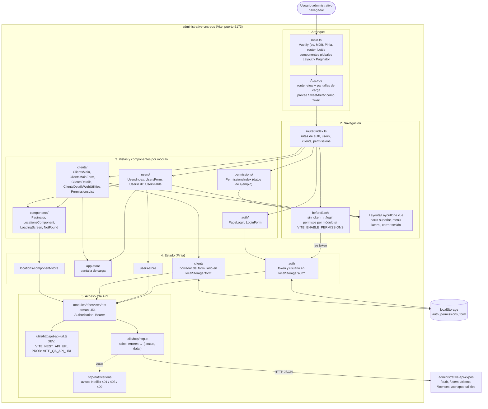
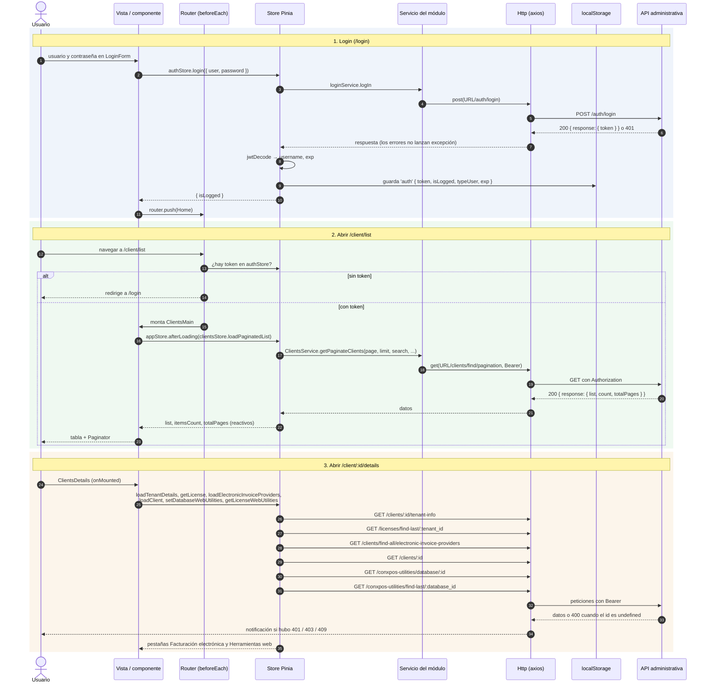
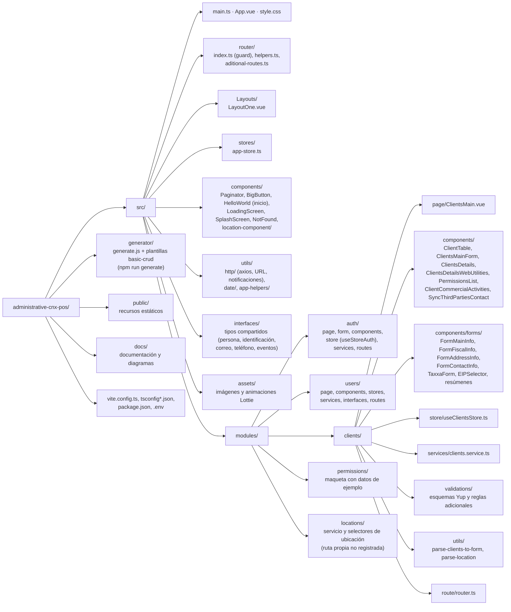

# Arquitectura: front administrativo Conexión POS

`administrative-cnx-pos` es el panel web con el que el equipo de Conexión POS administra usuarios internos y clientes. Desde aquí se registran los clientes, se aprovisiona su esquema en la base del POS, se configuran sus credenciales de facturación electrónica (Taxxa), sus licencias y su acceso a las herramientas web (`web-reporter-v2`). Todo lo hace a través de la API `administrative-api-cxpos`.

| Aspecto | Valor |
| --- | --- |
| Framework | Vue 3 (`<script setup>` + TypeScript) sobre Vite 6 |
| UI | Vuetify 3 (iconos MDI, idioma español), SweetAlert2, Notiflix, Lottie |
| Estado | Pinia; sesión y borrador de cliente persistidos con `useStorage` (`@vueuse/core`) |
| Navegación | Vue Router 4 con guard global |
| HTTP | axios envuelto en `src/utils/http/http.ts` |
| Validación | Yup y reglas propias en `modules/clients/validations/` |
| Puerto de desarrollo | 5173 (`npx vite`) |
| Backend | `administrative-api-cxpos` (puerto 3620) |

## 1. Vista general

Fuente del diagrama: [arquitectura.mmd](arquitectura.mmd).

## 2. Capas y responsabilidades

| Capa | Ubicación | Responsabilidad |
| --- | --- | --- |
| Arranque | `src/main.ts`, `src/App.vue` | Registra Vuetify, Pinia, router, Lottie y los componentes globales `Layout` y `Paginator`; provee SweetAlert2 como `swal`. |
| Navegación | `src/router/` | Une las rutas de cada módulo y protege la navegación. |
| Layout | `src/Layouts/LayoutOne.vue` | Barra superior, menú lateral y cierre de sesión. |
| Vistas | `src/modules/<módulo>/page/` y componentes enrutados | Pantallas asociadas a una ruta. |
| Componentes | `src/modules/<módulo>/components/`, `src/components/` | Formularios, tablas, tarjetas y piezas reutilizables. |
| Estado | `src/modules/<módulo>/store(s)/`, `src/stores/` | Datos de pantalla, paginación, filtros y llamadas a servicios. |
| Servicios | `src/modules/<módulo>/services/` | Construyen la URL de la API y el encabezado `Authorization`. |
| HTTP | `src/utils/http/` | URL base por ambiente, query string, axios y notificaciones de error. |

### Configuración de la API

`src/utils/http/get-api-url.ts` elige la URL base:

| Modo | Variable |
| --- | --- |
| Desarrollo (`vite`) | `VITE_NEST_API_URL` |
| Build de producción (`vite build`) | `VITE_QA_API_URL` |

`VITE_ENABLE_PERMISSIONS=true` activa la validación de acceso por módulo en el router. El archivo `.env` local apunta a `http://localhost:3620` con permisos desactivados.

### Cliente HTTP y errores

`Http.get/post/put/patch/delete` nunca lanzan excepción ante una respuesta de error: devuelven `{ status, data }` y, salvo que se indique `showHttpError: false`, muestran un aviso Notiflix para 401, 403 y 409. Por eso los stores comparan `response.status` en lugar de usar `try/catch`.

### Sesión

- `authStore.login` guarda en `localStorage` (`auth`) el token, `isLogged`, el nombre de usuario y `exp`, decodificados del JWT.
- El guard redirige a `/login` si no hay token y envía `/` a `/login`.
- Los servicios toman el token del store de auth al cargarse el módulo.
- `authStore.authCheck` compara `exp` con segundos, pero la API lo emite en milisegundos, así que la sesión nunca se considera vencida en el front.

## 3. Flujo de datos

Fuente del diagrama: [flujo-datos.mmd](flujo-datos.mmd).

### Patrón de una pantalla

1. La vista se monta y llama a una acción del store, normalmente envuelta en `appStore.afterLoading()` para mostrar la pantalla de carga.
2. La acción del store llama al servicio del módulo, que arma la URL con `getApiUrl()` y el `Authorization: Bearer`.
3. `Http` ejecuta la petición con axios y devuelve la respuesta (o `{ status, data }` si hubo error).
4. El store guarda `response.data.response` en su estado (`list`, `itemsCount`, `totalPages`, `selectedItem`...) y la vista se actualiza por reactividad.
5. Los componentes hijos se comunican con eventos `{ name, data }` (`EmitInterface`) y el `Paginator` global emite `onChangePage`.

### Formulario de cliente

El formulario vive en `clientsStore.form`, persistido en `localStorage` (`form`). Si el usuario sale sin guardar, `ClientsMainForm` detecta el borrador al volver. Cada sección se valida por separado (principal, fiscal, ubicación, contacto, actividades) antes de enviar `POST /clients` o `PUT /clients/:id`.

## 4. Estructura del proyecto

Fuente del diagrama: [estructura.mmd](estructura.mmd).

## 5. Generador de módulos

`npm run generate` ejecuta `generator/generate.js`: pide un nombre en PascalCase y copia las plantillas de `generator/basic-crud` (page, components, store, services, routes, interfaces) a `src/modules/<nombre-kebab-case>`. Los módulos `permissions` y `locations` conservan partes de esa plantilla sin adaptar.

## 6. Observaciones técnicas

Detectadas al leer el código y al probar el front contra la API local; no se corrigieron en esta documentación.

| Tema | Detalle |
| --- | --- |
| Llamadas con `undefined` | En `/client/:id/details`, si el cliente no tiene tenant o base web se llama a `/licenses/find-last/undefined` y `/conxpos-utilities/find-last/undefined`; la API responde 400. |
| Permisos | `/permissions/list` muestra datos fijos definidos en `PermissionsTable.vue`; el servicio de permisos apunta a rutas que la API no publica. |
| Vencimiento de sesión | `exp` se compara en segundos contra un valor en milisegundos. |
| Token en servicios | Los servicios leen el token del store al importarse; tras un login sin recargar la página dependen de que el objeto de sesión se actualice en el mismo store. |
| Login | Presionar Enter no envía el formulario; solo el botón. |
| Módulo locations | `LocationsRouter` no está registrado en el router y `LocationsIndex` llama acciones que el store no implementa. |
| Token en `localStorage` | Accesible desde JavaScript; relevante ante XSS. |

## 7. Documentos relacionados

- [MODULOS.md](MODULOS.md): rutas, componentes, stores y endpoints de cada módulo.
- [README.md](README.md): índice de la carpeta y cómo ejecutar el proyecto.
- Documentación de la API: `administrative-api-cxpos/docs/`.
