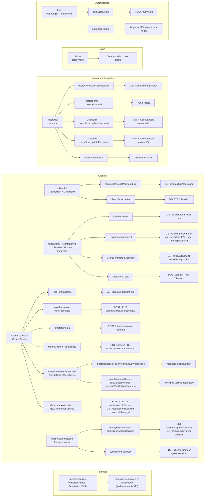

# Módulos del front administrativo

Detalle de cada módulo de `src/modules`: rutas, vistas, store y endpoints de la API que utiliza.

## Mapa de funciones

Fuente del diagrama: [funciones.mmd](funciones.mmd).

## Rutas registradas

| Ruta | Vista | Módulo |
| --- | --- | --- |
| `/login` | `auth/page/PageLogin.vue` | auth |
| `/home` | `components/HelloWorld.vue` | inicio |
| `/users/list` | `users/page/UsersIndex.vue` | users |
| `/users/table` | `users/components/UsersTable.vue` | users |
| `/client/list` | `clients/page/ClientsMain.vue` | clients |
| `/client/form` | `clients/components/ClientsMainForm.vue` (crear) | clients |
| `/client/form/:id` | `clients/components/ClientsMainForm.vue` (editar) | clients |
| `/client/:id/details` | `clients/components/ClientsDetails.vue` | clients |
| `/client/:id/permissions` | `clients/components/PermissionsList.vue` | clients |
| `/permissions/list` | `permissions/page/PermissionsIndex.vue` | permissions |
| `/permissions/table` | `permissions/components/PermissionsTable.vue` | permissions |
| cualquier otra | `components/NotFound.vue` | — |

## auth

| Pieza | Archivo | Función |
| --- | --- | --- |
| Vista | `page/PageLogin.vue` → `components/DesktopForm.vue` → `form/LoginForm.vue` | Formulario de usuario y contraseña. |
| Store | `store/useStoreAuth.ts` (`auth`) | `login`, `logout`, `authCheck`; persiste la sesión en `localStorage`. |
| Servicio | `services/Auth.services.ts` | `POST /auth/login`. |

## users

Usuarios del panel administrativo (no son usuarios del POS).

| Pieza | Archivo | Función |
| --- | --- | --- |
| Vista | `page/UsersIndex.vue` | Listado con búsqueda, filtro activo/inactivo y diálogos. |
| Componentes | `UsersTable`, `UsersCards`, `UsersList` | Listado y paginación. |
| | `UsersForm` | Crear usuario (contraseña de 6 a 20 caracteres en el front; la API exige 3 a 12 al cambiarla). |
| | `UsersEdit` | Cambiar nombre de usuario o contraseña (requiere la actual). |
| | `UsersPermissions`, `UsersSearcher`, `UsersDetails` | Maqueta de permisos, búsqueda avanzada y detalle generado sin uso. |
| Store | `stores/users.store.ts` (`users-store`) | Paginación, diálogo, `add`, `delete`, `updateUsername`, `updatePassword`. |
| Servicio | `services/users.services.ts` | `/users`, `/users/find/pagination`, `/users/update-username/:id`, `/users/update-password/:id`, `DELETE /users/:id`. |

## clients

Núcleo funcional del panel.

| Pieza | Archivo | Función |
| --- | --- | --- |
| Listado | `page/ClientsMain.vue`, `components/ClientTable.vue` | Búsqueda, filtro por estado de licencia y activación. El estado mostrado es Inactivo, Vencido, Por vencer (menos de 10 días) o Activo. |
| Formulario | `components/ClientsMainForm.vue` + `components/forms/*` | Secciones principal, fiscal, ubicación (`LocationsComponent`), contacto (`SyncThirdPartiesContact`) y actividades (`ClientCommercialActivities`). |
| Detalle | `components/ClientsDetails.vue` | Pestaña **Proveedor de facturación electrónica**: credenciales Taxxa, creación del esquema y licencia del POS. Pestaña **Herramientas web**: `ClientsDetailsWebUtilities` y licencia web. |
| Herramientas web | `components/ClientsDetailsWebUtilities.vue` | Usuario y contraseña del web reporter, IP y base MySQL, activación. |
| Servicios contratados | `components/PermissionsList.vue` | Marca servicios del sistema y los sincroniza con el tenant del cliente. |
| Store | `store/useClientsStore.ts` (`clients`) | Estado del listado, formulario persistido, catálogos, tenant, Taxxa y herramientas web. |
| Servicio | `services/clients.service.ts` | Todas las rutas `/clients/*`, `/licenses/*` y `/conxpos-utilities/*`. |
| Validación | `validations/validations.ts`, `validations/extraValidations.ts` | Esquemas Yup por sección; tipos de documento DIAN 31 y 50 se tratan como empresa. |
| Utilidades | `utils/parse-clients-to-form.ts`, `utils/parse-location.ts` | Convierten la respuesta de la API al formulario de edición. |

### Orden habitual de alta de un cliente

1. `/client/form`: crear el cliente (`POST /clients`).
2. `/client/:id/details`, pestaña de facturación: registrar credenciales Taxxa y crear el esquema (`POST /clients/:id/create-schema`).
3. Misma pestaña: crear la licencia del POS (`POST /licenses`).
4. `/client/:id/permissions`: asignar servicios del sistema.
5. Pestaña Herramientas web: crear usuario web, registrar la base MySQL y fijar la licencia web.

## permissions

Generado desde la plantilla CRUD y no conectado a datos reales: `PermissionsTable.vue` muestra módulos y acciones fijos (`arrayTest`). `permissions.services.ts` apunta a `/permissions/*`, rutas que la API no publica.

## locations

Servicio y store para países, departamentos, municipios y barrios (`GET /clients/get*`). Lo usa `LocationsComponent` en el formulario de cliente. `LocationsRouter` y `LocationsIndex.vue` existen pero la ruta no está registrada.

## Componentes compartidos (`src/components`)

| Componente | Uso |
| --- | --- |
| `Paginator.vue` | Global; emite `onChangePage` con la página elegida. |
| `location-component/LocationsComponent.vue` | Selectores encadenados país → departamento → municipio y dirección. |
| `LoadingScreen.vue`, `SplashScreen.vue` | Pantallas de carga controladas por `app-store`. |
| `HelloWorld.vue` | Pantalla de inicio (`/home`). |
| `NotFound.vue` | Página 404. |
| `BigButton.vue` | Botón grande configurable. |
